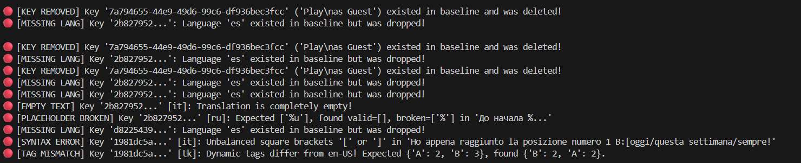
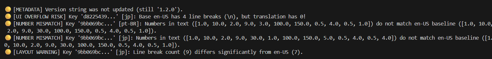
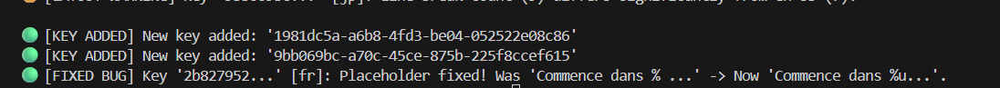

# Release Findings: `localisations_1_2_1.plist`

**Verdict:** 🔴 **DO NOT SHIP** (7 Blockers, 5 Warnings, 3 Infos)

Below is the Monday-morning release assessment comparing candidate `localisations_1_2_1.plist` against live production `localisations_1_2_0.plist`.

## 1. Highest-Risk Issues: Ship Blockers (🔴 Must Fix Before Release)
1. **Entire Language Dropped (`es`):** Spanish (`es`) was present across all keys in `1.2.0` but is completely missing from `1.2.1` (`2b827952...` and `d8225439...`). Spanish players will face missing text or fallbacks.
2. **Deleted Production Key (`7a794655-44e9-49d6-99c6-df936bec3fcc`):** The *"Play\nas Guest"* string was completely removed. Unless the Guest login button was removed from the client binary, this will break the login screen.
3. **Broken Format Specifier (`2b827952...` - `ru`):** Russian changed from `До начала %u...` to `До начала %...` (dropped the `u` type specifier). This can crash the client string formatter or render literal garbage during the countdown.
4. **Empty Translation (`2b827952...` - `it`):** Italian translation for *"Starting in %u..."* was wiped out to an empty string `""`.
5. **Unclosed Bracket & Missing Dynamic Tag (`1981dc5a...` - `it`):** Italian (`Ho appena raggiunto la posizione numero 1 B:[oggi/questa settimana/sempre!`) is completely missing the `A:[...]` tag AND is missing the closing bracket `]` on `B:[...`. This will break the client tag parser.
6. **Missing Choice Option in Dynamic Tag (`1981dc5a...` - `tk`):** Turkish (`B:[Bugün/Tüm zamanlarda]`) only has 2 slash-separated options inside tag `B` instead of 3 (missing "this week" compared to `en-US` `B:[today/this week/all time]`), risking an index out-of-bounds error or wrong leaderboard label.

  

## 2. Medium-Risk Issues: Warnings (🟡 Requires Human Review)
1. **Wrong Penalty Number in Game Rules (`9bb069bc...` - `pt-BR`):** English states *"a **30** seconds penalty"*, but Brazilian Portuguese says *"uma penalidade de **3** segundos"* (dropped the zero — players will see rules that contradict actual gameplay).
2. **Wrong Multiplier Cap in Game Rules (`9bb069bc...` - `jp`):** English states the multiplier decreases by 0.5 *"to a minimum of **1.0**"*, whereas Japanese ends with `最大で 4 倍減少する` (referencing **4** instead of **1.0**).
3. **UI Overflow Risk — Missing Line Breaks (`d8225439...` - `jp`):** Base `en-US` formats this text across 5 lines (`4` `\n` breaks) to fit the modal. Japanese (`jp`) has `0` line breaks, risking horizontal UI overflow.
4. **Layout Warning — Extra Line Breaks (`9bb069bc...` - `jp`):** Japanese has `9` line breaks compared to `7` in `en-US`, risking vertical overflow in the rules panel.
5. **Version Metadata Not Updated:** The `<version>` tag inside `localisations_1_2_1.plist` still reads `1.2.0`.

## 3. Safe Changes & Fixed Bugs (🟢 No Action Needed)
- **Fixed Regression (`2b827952...` - `fr`):** In `1.2.0`, French had a broken placeholder (`Commence dans % ...`). In `1.2.1`, it was repaired to `Commence dans %u...`. Rather than flagging this change as a risk, our tool explicitly recognizes it as a fix against the `en-US` baseline.
- **Safe Tag Reordering (`1981dc5a...` - `de`, `tk`):** German and Turkish place `B:[...]` before `A:[...]` due to natural grammar. Validated cleanly without false alarms.
- **New Language Added (`jp`):** Japanese translations were added across all keys.

## 4. Semantic Issue Caught by Manual Inspection (Tool Blind Spot)
- **Semantic Contradiction (`9bb069bc...` - `it`):** At the end of the billiard rules, English says *"decrease it by 0.5 to a **minimum** of 1.0"*, while Italian says *"diminuirà di 0,5 fino a un **massimo** di 1,0"* ("up to a **maximum** of 1.0"). Because the number `1,0` is present, heuristic rules pass — illustrating where deterministic checks end and optional LLM review could add value.

## Proposed Team Workflow
1. **Pre-Merge CI Check (Primary):** Run `python loc_check.py <live.plist> <candidate.plist>` automatically in CI on every Pull Request modifying `.plist` files. Because the script exits with code `1` on any `BLOCKER`, broken placeholders, unclosed tags, and dropped languages are caught before merge.
2. **Release Morning Triage (Secondary):** Releasers run the CLI tool (or read the CI summary artifact) in <1 minute to make an immediate Ship/No-Ship call and spot-check `Warnings` with designers/translators.